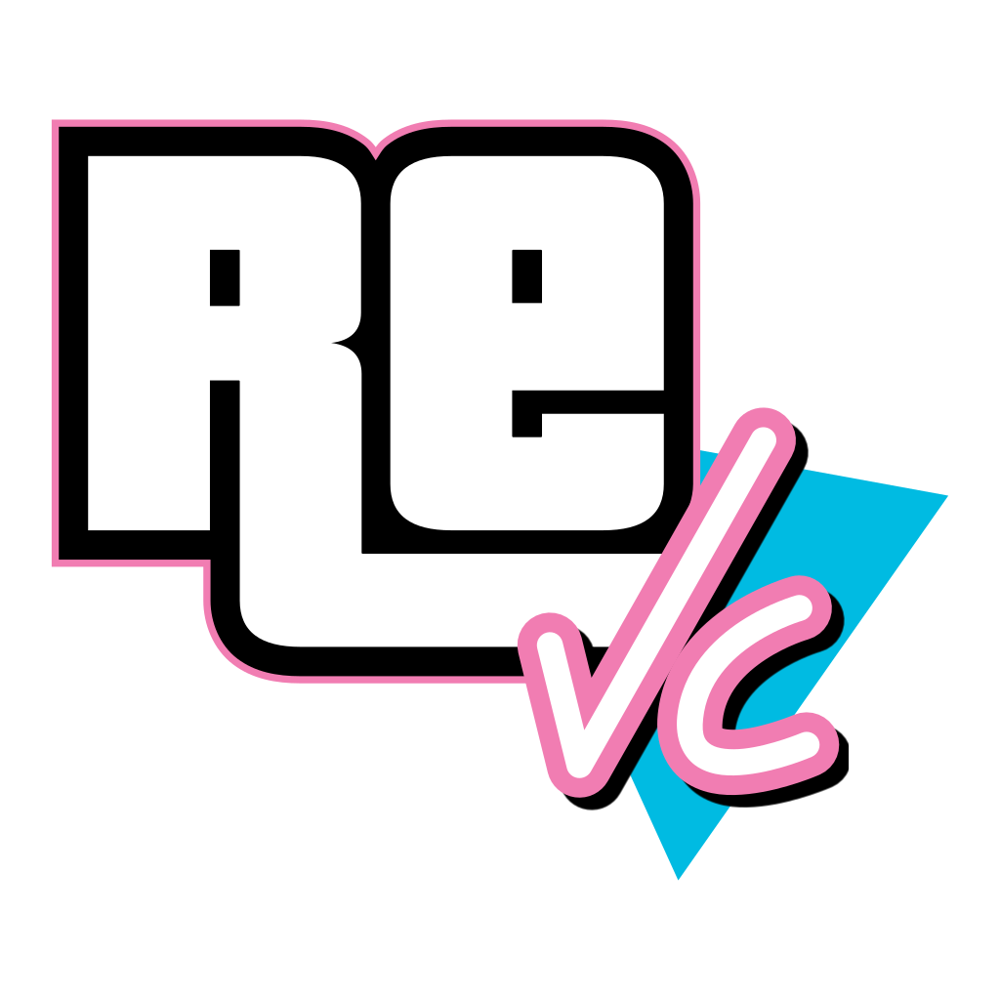

<div align="center">
  
</div>

# reVC for Nintendo Switch 2 (Usimg kaiHEN)

A homebrew port of reVC (port
of Grand Theft Auto: Vice City) to the Nintendo Switch 2, running under
the kaiHEN homebrew environment.

This is a recompile of the existing reVC Nintendo Switch 1 port for
Switch 2, using the [ounce-devkit](https://github.com/ouncebrew/ounce-devkit):

**libounce** replaces libnx, and **OunceVK** provides the OpenGL/EGL driver for
the Switch 2 GPU. The renderer is librw (OpenGL ES 3 via GLFW); audio is OpenAL.

> This project contains **no game assets** and distributes none.

## You MUST bring your own game

reVC is only an engine and it ships with **none of the game's data**. 

To play, you must own a legitimate copy of the **original** GTA: Vice City (e.g. I used the PC version downloaded from Steam) and supply its files yourself. 

Nothing in this repository or its releases includes
Rockstar/Take-Two copyrighted content, and none will be provided. 

**Piracy is not supported.**

## Legal note

reVC is reverse-engineered code intended for **educational, documentation and modding** purposes only. The original repositories were taken down from GitHub following a DMCA request, which is why several links are not able to be supplied.

Publishing or redistributing this code may carry the same risk. Use it for preservation and homebrew on hardware you own; don't use it commercially or to enable piracy, and keep derivative work open and credited.

---

## Install (on your Switch 2)

1. Download **`reVC-oal-switch2.tar.xz`** from this project's
   [Releases](../../releases).
2. Take your **own** GTA: Vice City (PC) install folder and extract the release archive over it, letting reVC's `data/`, `models/`, `TEXT/`, `neo/` and `reVC.nro` merge in on top of the game files.
3. Copy that merged folder onto your SD card as **`/switch/reVC/`** — the NRO and all game data live together in that one folder:

   ```
   /switch/reVC/
   ├── reVC.nro
   ├── data/  models/  TEXT/  neo/   (GTA VC + reVC's files merged)
   ├── anim/  audio/  ...            (from your GTA VC copy)
   └── gamecontrollerdb.txt
   ```
4. Launch **reVC** from hbmenu under kaiHEN.

It renders at the console's native resolution and is full-screen in both
handheld and docked modes.

## Troubleshooting (logs)

The build writes **`revc_log.txt`** in the same folder as the NRO
(`/switch/reVC/`). It captures the game's startup output live and, on a crash,
appends a CPU exception dump (fault type + registers). If it crashes on boot or
black-screens, grab that file — it points straight at the failing stage. See
[`BUILDING.md`](BUILDING.md#diagnostics) for how a crash address is mapped back
to source with the matching `reVC.elf`.

## Building from source

The Switch 2 changes are already in this tree (librw is vendored and pinned), so
it's a one-command build once the toolchain is set up:

```sh
./build-switch2.sh
```

Full prerequisites and steps are in **[`BUILDING.md`](BUILDING.md)**.

## Credits

kaiHEN: https://github.com/ouncebrew/kaihen
Ounce-Devkit: https://github.com/ouncebrew/ounce-devkit
Original reVC: https://github.com/mrxenginner/reVC
Graber (Original Creator of NS1 Port)

## License / notice

See **[`NOTICE.md`](NOTICE.md)**. The upstream reVC readme is kept here as
[`README.upstream-reVC.md`](README.upstream-reVC.md).
